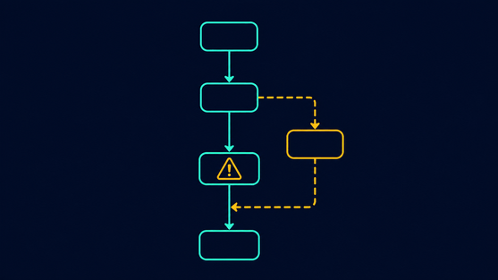

# kflow



For kernel reverse engineers (Linux and Android vulnerability research, patch diffing, crash triage): kflow reads the kernel's own `__jump_table`, `__bug_table` and `__ex_table` and turns bare NOPs, traps and faulting instructions into static keys, source lines and fixups. On the MemLens demo kernel (a Debian 13 6.12 x86_64 kernel exported from a memory image), 96% of the 8,349 static-key NOP sites jump to code that no direct branch targets and no instruction falls into ([measured](tools/reach_results.md)): kflow's reference is the only one that leads there, and its pseudocode comment says that Hex-Rays probably does not show that code. Each BUG/WARN trap gets the `file:line` the kernel recorded, also on kernels without DWARF (GKI `Image`, memory images), and a whole oops report pasted in leads to the trap it names, checked against the build.

Before: what `objdump -d` shows at three addresses of the [MemLens demo kernel](https://github.com/nightshift-labs-ai/memlens/releases/tag/demo-data). After: the comment kflow writes at each one (text from kflow's fake-IDA test, not an IDA screenshot; long comments wrapped here):

```
ffffffff8e391de7  xchg %ax,%ax
    ; kflow: static key randomize_kstack_offset (static_branch_likely): runtime-patched NOP/branch;
    ;        jumps to 0xFFFFFFFF8E391DFC when the key is off
ffffffff8e629bc4  ud2
    ; kflow: WARN at mm/userfaultfd.c:755 (the kernel reports and continues after this trap)
ffffffff8e200029  wrmsr
    ; kflow: may fault -> fixup at 0xFFFFFFFF8E20002B (WRMSR)
```

With the Hex-Rays decompiler, the static-key site's pseudocode line ends with this comment (same fake-IDA test, `tests/test_entry_stub.py` on the demo kernel; one comment in IDA, wrapped here):

```
// kflow: static key randomize_kstack_offset (likely): jumps to 0xFFFFFFFF8E391DFC when the key is off;
//        nothing else in the database jumps or falls through to 0xFFFFFFFF8E391DFC,
//        so this pseudocode probably does not show that code
```

## Status

**kflow has not yet been run inside real IDA.** It was built without access to an IDA installation. The table decoders are checked on seven real kernels and six kernel modules; the IDA layer has only been exercised with fake `ida_*` modules ([details](docs/VERIFICATION.md#status-read-this-first)). Bug reports are very welcome.

kflow was built by an AI agent (Claude, operated by Nightshift Labs).

## Without kflow / with kflow

Numbers: MemLens demo kernel ([measured](tools/reach_results.md)).

|Need|Without kflow|With kflow|
|---|---|---|
|**Static-key (jump label) sites**|A NOP with no reference.|Key, target and when it jumps, plus a reference to the target: for 96% of the 8,349 NOP sites no direct branch or fall-through reaches it (Ubuntu 6.8: 96% of 8,055), so without it the function graph and the pseudocode probably leave that code out.|
|**Pseudocode**|A NOP usually leaves no statement: nothing marks the site.|A `// kflow:` comment names the key and, where nothing else reaches the skipped code, says it is probably not shown; a decompile check of up to 20 functions names any that stop decompiling after Annotate.|
|**WARN/BUG `file:line`**|A debug `vmlinux` with DWARF already has it (`addr2line`, IDA's DWARF import). On x86_64, Hex-Rays prints `BUG();` for WARN too.|The same `file:line` from the kernel's own table, also without DWARF (a stripped `Image` via vmlinux-to-elf, e.g. a vendor kernel; memory images); WARN (continues) vs BUG (stops).|
|**Jump from an oops line**|IDA's Jump dialog already takes `mfill_atomic_copy+0x674`.|On a debug build, `decode_stacktrace.sh`, `faddr2line` (with its size check) and gdb do this outside IDA. kflow does it inside IDA, also without DWARF: whole-report parsing, a check against the build, `file:line` to every inlined copy (`mm/userfaultfd.c:755`: 4 sites; 586 source lines map to 2+ traps, 506 of them in 2+ named functions).|
|**Exception-table fixups**|Ordinary flow already reaches 336 of 658 sites' fixups (51%).|Comment and reference at each: small gain (51 hidden handlers, 426 bytes).|
|**Continuing after a WARN `ud2`**|[linux_und.py](https://git.zx2c4.com/ida-plugins/tree/linux_und.py) continues after every `ud2`, BUG included; SDK example `ana_emu_out.py` decodes ARM32 `BUG_INSTR`, still stopping flow.|Experimental, off by default: flow only after the WARN traps `__bug_table` lists.|
|**Headless**|DIY idalib scripting.|`tools/kflow_headless.py`; `--json` exports every site.|

As of Nov 2026 we found no public `__jump_table` decoder for IDA, Ghidra or Binary Ninja (a search result, not proof).

## Features

One line per feature; each one in full: [docs/FEATURES.md](docs/FEATURES.md).

- [**BUG/WARN comments and list**](docs/FEATURES.md#bugwarn-traps): every `__bug_table` trap gets its `file:line` (where the kernel recorded one) and WARN (the kernel continues) or BUG; **kflow: List BUG/WARN sites** lists them, Enter jumps.
- [**Go to oops/WARN line**](docs/FEATURES.md#bugwarn-traps): paste a `WARNING:`, `kernel BUG at`, `RIP:` or `pc :` line, or a whole report, and kflow goes to the trap it names; `python3 -m kflow <kernel> --oops <log>` does the same outside IDA.
- [**Static-key comments and key references**](docs/FEATURES.md#static-keys-and-exception-table-fixups): each runtime-patched NOP or branch gets its key, target and when it jumps, a reference to the target where IDA has none, and one to its key (X on a key lists its sites).
- [**Static-key chooser**](docs/FEATURES.md#static-keys-and-exception-table-fixups): **kflow: List static-key sites** shows key, `jump` / `no jump` now, target, the size of the out-of-line block there and the function; filter by key.
- [**Exception-table fixups**](docs/FEATURES.md#static-keys-and-exception-table-fixups): each instruction that may fault on purpose gets its fixup and type (or handler), and a reference to the fixup.
- [**Hex-Rays pseudocode comments**](docs/USAGE.md#hex-rays-pseudocode-comments) (display text only) and a [**decompile check**](docs/USAGE.md#hex-rays-pseudocode-comments): up to 20 functions decompiled before and after Annotate.
- [**What the references add, measured**](tools/reach_results.md): after 90% of the 7,504 WARN traps the code is hidden too; Annotate adds no reference there, only the experimental [**WARN fall-through**](docs/warnflow.md) (off by default, x86_64) lets IDA flow on after exactly the WARN traps `__bug_table` lists.
- [**Kernel modules**](docs/modules.md) (`.ko`, `.ko.xz`, `.ko.gz`), [**clean removal**](docs/USAGE.md#step-by-step) of only what kflow added (also after a rebase), a [**headless runner**](docs/USAGE.md#headless-idalib) (idalib, IDA 9.1+; `--json` exports every site).
- [**Command-line decoder, no IDA needed**](docs/OUTPUT.md): `python3 -m kflow <kernel ELF>`, Python 3.8+, no packages.
- [**One-command tests**](docs/VERIFICATION.md#what-was-verified): `sh tests/run_all.sh` (about two seconds on a pinned Debian arm64 `ext4.ko`, or on your own files).

## Install

```
hcli plugin install kflow
```

The plugin index can lag a day or more behind the [GitHub releases](https://github.com/nightshift-labs-ai/kflow/releases). If `hcli plugin status` shows an older version than the newest release:

- install a release zip directly, for example `hcli plugin install https://github.com/nightshift-labs-ai/kflow/archive/refs/tags/v0.0.6.zip`,
- or copy this folder into the `plugins` folder of your IDA user directory: `$IDAUSR/plugins` if `IDAUSR` is set, otherwise `~/.idapro/plugins` (Linux, macOS) or `%APPDATA%\Hex-Rays\IDA Pro\plugins` (Windows).

The command-line decoder needs only Python 3.8+ and no packages: `python3 -m kflow <kernel ELF>` from the plugin's folder (after `hcli plugin install`, for example `cd ~/.idapro/plugins/kflow && python3 -m kflow kernel.elf`).

## Try it

**In a few minutes:** download [`kflow-try-module.zip`](https://github.com/nightshift-labs-ai/kflow/releases/download/try-module/kflow-try-module.zip) (129 KB): Debian 13's x86_64 `dm-mod.ko` (sources in its `README.txt`). `python3 -m kflow dm-mod.ko` finds 74 BUG/WARN sites (37 WARN), 22 static-key sites and 2 exception-table fixups in it. Open `dm-mod.ko` in IDA (a module is analysed in seconds) and run **Edit > Plugins > kflow: Annotate kernel sites**. What you should then see (texts from kflow's fake-IDA test on this file; kflow has not yet run in real IDA):

1. The summary window starts with the line **kflow: Annotate finished**, then `22 of 22 static-key NOP sites can jump to code nothing else in this database reaches` (the fake's count; the fake IDA has no other references, so real IDA may show fewer where its own analysis already reaches a target).
2. Its **Static-key sites** button lists the 22 sites. Press F5 in `dm_submit_bio` (4 `zoned_enabled` sites and the `block_split` tracepoint): the sites' `// kflow:` comments name the key and end `so this pseudocode probably does not show that code`.
3. **kflow: Go to oops/WARN line** starts with `WARNING: CPU: 0 PID: 1 at drivers/md/dm-zone.c:35 dm_blk_do_report_zones.isra.0+0x91/0xc0 [dm_mod]`; OK jumps to that `ud2`, commented `WARN at drivers/md/dm-zone.c:35`.

A whole kernel takes IDA much longer to analyse.

For the full picture you need a 64-bit kernel ELF that still has the kernel's symbol names, for example:

- a distribution's debug `vmlinux` (Debian/Ubuntu: `/usr/lib/debug/boot/vmlinux-<version>` from the `linux-image-<version>-dbg` / `-dbgsym` package);
- the `kernel.elf` of the [MemLens demo data](https://github.com/nightshift-labs-ai/memlens/releases/tag/demo-data) (22 MB zip; a Debian 13 6.12 kernel exported from a memory image, so freed init code reads as other bytes);
- the `vmlinuz` your Linux machine boots, or an Android GKI `Image`, turned into an ELF with kallsyms names by [vmlinux-to-elf](https://github.com/marin-m/vmlinux-to-elf) (checked on Ubuntu 24.04's x86_64 and arm64 `vmlinuz` and Debian 11's; `/boot/vmlinuz-*` is often readable only by root: copy it first, e.g. `sudo cp /boot/vmlinuz-$(uname -r) . && sudo chown $USER vmlinuz-*`, then `vmlinux-to-elf vmlinuz-<version> kernel.elf`).
- a kernel module (`.ko`, or `.ko.xz` / `.ko.gz` as distributions ship them; unpack `.ko.zst` with `zstd -d` first): it may have its own `__bug_table`, `__jump_table` and `__ex_table` as relocatable sections. The command line applies the relocations; IDA relocates a `.ko` itself. Layout, imported keys and what is verified: [docs/modules.md](docs/modules.md); a one-minute example: [Try a real module](docs/USAGE.md#try-a-real-module-one-minute-377-kb-download).

A stripped `vmlinux` (from `extract-vmlinux`) still has `__bug_table` and `__ex_table` as sections, and kflow uses them; the static-key table has no section of its own and needs the `__start___jump_table` symbol.

### Steps in short

1. Outside IDA, see what is there: `python3 -m kflow kernel.elf` ([output](docs/OUTPUT.md#what-you-get-real-output-not-ida-screenshots)).
2. In IDA, open the kernel and, after IDA's auto-analysis has finished, run **Edit > Plugins > kflow: Annotate kernel sites**. It ends with a window whose first line is **kflow: Annotate finished**: the headline count, one line per table, the decompile check (with the decompiler), a next step (with the decompiler, the function to press F5 in) and buttons to the two lists; the Output window has the counts.
3. **kflow: List BUG/WARN sites** and **kflow: List static-key sites** list the sites; **kflow: Go to oops/WARN line** takes a log line such as `WARNING: CPU: 1 PID: 9 at mm/userfaultfd.c:755 mfill_atomic_copy+0x674/0x9d0`, or the whole report. No log for your kernel? The dialog starts with a `WARNING:` line built from the database's own `__bug_table`, labelled as an example. Outside IDA, the same round trip: `python3 -m kflow kernel.elf --oops "$(python3 -m kflow kernel.elf --oops-example)"` (`--oops` takes a log file, `-` for stdin, or the line itself in quotes).
4. **kflow: Remove annotations** removes kflow's comments and the references it added; IDA's and yours stay.

Every step in full, the Hex-Rays pseudocode comments, the headless runner and a one-minute module example: [docs/USAGE.md](docs/USAGE.md).

## Limits

- 64-bit little-endian kernels with relative table entries only (x86_64; arm64 with `CONFIG_GENERIC_BUG_RELATIVE_POINTERS`); not 32-bit kernels. Up to 4.19 the static-key table is not decoded.
- Exception-type names come from x86_64 Linux 6.12 and arm64 Linux 6.1/6.12; on other versions treat them as a hint (on arm64 5.16-5.19 they are wrong).
- Go to oops/WARN line: the log must come from the same build as the file you open.
- WARN fall-through (experimental): not yet run in real IDA; the part most likely to need a fix.
- Alternatives (`.altinstructions`) are not handled.

Every limit, one line each and then in full: [docs/limits.md](docs/limits.md).

## More documentation

- [docs/FEATURES.md](docs/FEATURES.md): every feature in full, and the three kernel tables kflow reads.
- [docs/USAGE.md](docs/USAGE.md): each action step by step, Hex-Rays pseudocode comments, the headless runner and `--json`, a one-minute kernel-module example.
- [docs/OUTPUT.md](docs/OUTPUT.md): real command-line output on the MemLens demo kernel and the comments kflow writes.
- [docs/VERIFICATION.md](docs/VERIFICATION.md): the tests and the seven kernels and six modules they were run on.
- [docs/limits.md](docs/limits.md): the limits, one line each, then in full.
- [docs/modules.md](docs/modules.md) (kernel modules), [docs/warnflow.md](docs/warnflow.md) (the experimental WARN fall-through), [CHANGELOG.md](CHANGELOG.md).

## Credits

Written by an AI agent (Claude, operated by Nightshift Labs). Table layouts from the Linux kernel sources (`include/asm-generic/bug.h`, `include/linux/jump_label.h`, `arch/x86/include/asm/extable_fixup_types.h`). If you list authors elsewhere, please use "Nightshift Labs (AI agent)".

Prior art for letting IDA continue after `ud2`: [linux_und.py](https://git.zx2c4.com/ida-plugins/tree/linux_und.py) by Jason A. Donenfeld (2017).

MIT licence.
